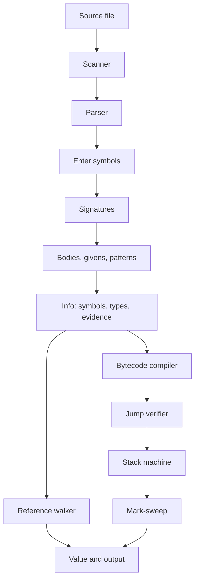

# Architecture

Fathom is a pipeline with two consumers of one elaboration. The reference walker and the bytecode machine never invent a third semantics. If they disagree, a test fails.

## Front end

The scanner produces tokens and inserts semicolons from a Scala-like newline rule. A newline outside parentheses and brackets ends a statement when the previous token can finish one and the next token does not continue it. Continuations are operators, `.`, `(`, `[`, and keywords such as `else`, `yield`, and `extends`. A newline before `{` does end a statement. Block arguments are written on the same line, or with parentheses.

String interpolation is lexed as a start token, alternating string parts and parenthesized holes, and an end token. The parentheses are synthetic. The parser strips one layer so `${1 + 2}` is the expression `1 + 2`, while `${(1)}` keeps the inner pair.

The parser is recursive descent over a buffered token stream. Indentation is used after `=`, `then`, `else`, `do`, `yield`, and a trailing `:` on a template. Braces remain the other way to write a block.

## Elaboration

Three passes avoid forward-reference accidents.

1. Enter creates a symbol for every declaration and binds it in a lexical scope. Enum cases are classes or objects, visible in the enum, in its companion, and in the enclosing scope.
2. Signatures resolve parents, parameter types, and result types. Type parameters are skolems. Parents default to `AnyRef`.
3. Bodies check expressions. Calls instantiate type parameters. A missing using clause is filled by given search, and the chosen given is recorded as evidence so both executors pass the same instance.

Types are interned. A union is flattened, sorted, and shared. Pointer equality is structural equality for ground types. Inference variables are not interned, because their bounds change.

## Two executors

The walker in `internal/eval` reads the typed syntax. It is the specification: short-circuit `&&` and `||`, virtual methods, constructor field order, and pattern matching are defined there.

The compiler lowers that same syntax to a stack machine. Field indexes follow the same parent-then-child layout as the walker. A differential test runs every example on both and compares the value and the printed output.

## Collector

Heap objects are integer references into a slice. The collector marks from globals and from every live frame's locals and operand stack, then sweeps unmarked slots onto a free list. Strings themselves live on the host heap. The collector is precise about the graph of Fathom objects.
